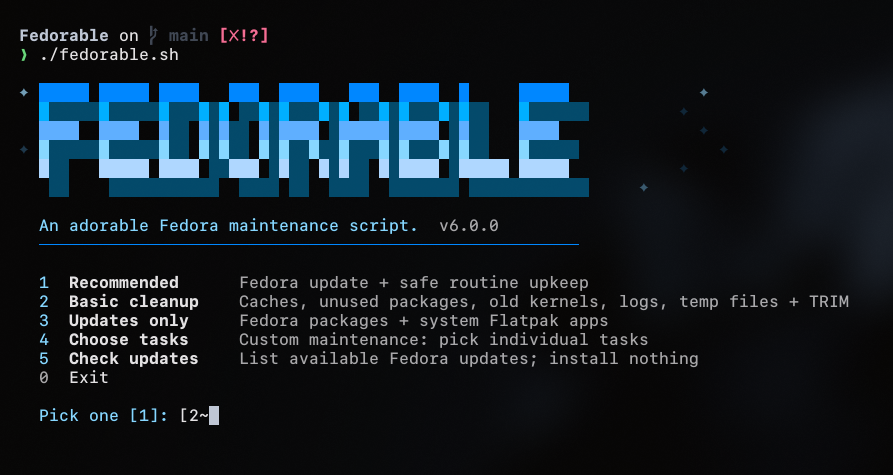
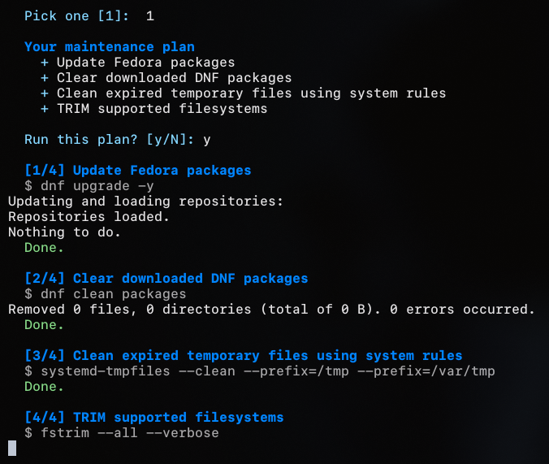
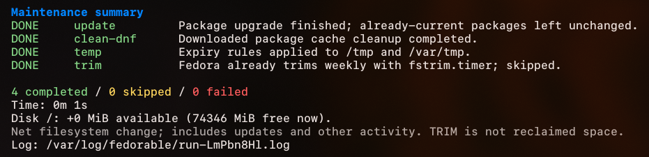

<div align="center">

# Fedorable

**An adorable Fedora maintenance script.**

[](https://fedoraproject.org)
[](https://www.gnu.org/software/bash/)
[](https://github.com/rpm-software-management/dnf5)
[](https://flatpak.org)
[](https://systemd.io)

[](https://github.com/V8V88V8V88/Fedorable/releases)
[](https://github.com/V8V88V8V88/Fedorable/actions/workflows/check.yml)
[](LICENSE)
[](https://github.com/V8V88V8V88/Fedorable/stargazers)



</div>

Fedorable gathers the usual Fedora upkeep into one small terminal menu: package updates, old kernels, logs, temporary files and Flatpaks. You pick a plan, see exactly what it will do, and only then let it run.

<p align="center">
  
  <br><br>
  
</p>

## Install

```bash
curl -fsSL https://raw.githubusercontent.com/V8V88V8V88/Fedorable/main/install.sh | sudo bash
```

Then run `fedorable` from anywhere. No need for `sudo`; it asks for your password once you confirm a plan. Run the install command again to update, or add `-s -- --uninstall` after `bash` to remove it.

To try it first without installing anything:

```bash
git clone https://github.com/V8V88V8V88/Fedorable.git
cd Fedorable
./fedorable.sh --recommended --dry-run
```

A dry run only shows the commands. It changes nothing and doesn't need root.

## Plans

| Plan | Menu | What it does |
| --- | --- | --- |
| `--recommended` | 1 (default) | Updates packages, clears the DNF cache, cleans expired temp files, runs TRIM |
| `--cleanup` | 2 | Unused packages, DNF cache, old kernels, old logs, temp files, unused Flatpak runtimes, thumbnails, coredumps, TRIM. No updates |
| `--updates` | 3 | Fedora packages and system Flatpak apps. No cleanup |
| `--tasks a,b` | 4 | Only the tasks you pick |
| `--full` | | Every update and cleanup task |
| `--check-only` | 5 | Lists available updates and installs nothing |

In the menu's task picker you can type numbers (`3,4,6`), names (`journal,temp`) or both.

### Tasks

| Task | What it does |
| --- | --- |
| `update` | Updates Fedora packages |
| `flatpak` | Updates system Flatpak apps |
| `clean-dnf` | Clears downloaded DNF packages |
| `autoremove` | Removes packages DNF marks as unused |
| `kernels` | Removes older kernels, keeping the newest three and the running one |
| `journal` | Rotates logs and keeps 14 days, up to 1 GB |
| `temp` | Cleans expired files in `/tmp` and `/var/tmp` using Fedora's own rules |
| `clean-flatpak` | Removes unused Flatpak runtimes |
| `thumbnails` | Clears your `~/.cache/thumbnails` |
| `coredumps` | Cleans expired coredumps |
| `trim` | Runs TRIM, unless Fedora's weekly `fstrim.timer` already does it |
| `boot-report` | Shows boot time and the slowest services |
| `failed` | Clears systemd's failed-unit status (it doesn't fix the service) |

Turn any task on or off with `--NAME` or `--no-NAME`, e.g. `fedorable --cleanup --no-kernels`.

## Options

| Option | |
| --- | --- |
| `--dry-run` | Show the commands without running them |
| `-y`, `--yes` | Skip the confirmation (needed when there's no terminal) |
| `-q`, `--quiet` | Hide the banner and progress messages |
| `--no-animation` | Show a still logo. `NO_COLOR=1` turns colors off |
| `--config FILE` | Use your own settings |
| `--list-tasks` | List all tasks |

## Safety

- You always see the plan before anything runs.
- The running kernel is never removed, and if the update fails, package and kernel removal are skipped.
- Flatpak tasks only touch system-wide installs.
- Only one copy can run at a time, and every run is logged to `/var/log/fedorable/`.
- Cleanup deletes files and can't be undone.

## Configuration

Copy `config/fedorable.conf.example`, edit it, and pass it with `--config`:

```ini
KERNELS_TO_KEEP=3
JOURNAL_VACUUM_TIME=14d
JOURNAL_VACUUM_SIZE=1G
MIN_DISK_SPACE_MB=2048
```

Write one `KEY=value` per line. A bad value stops the run before anything changes.

## Supported Fedora versions

| Fedora | Status |
| --- | --- |
| **45** | ✅ Supported and tested |
| **44** | ✅ Supported and tested |
| 43 | Should work, not tested |
| 42 and older | End of life, not supported |
| Silverblue, Kinoite, CoreOS | ❌ Not supported (they use rpm-ostree) |

## Development

```bash
make check
```

This runs ShellCheck and the tests (Python 3 is only needed for the tests). The code lives in `fedorable.sh` and `lib/`, and `install.sh` is the installer.

## License

[MIT](LICENSE)
